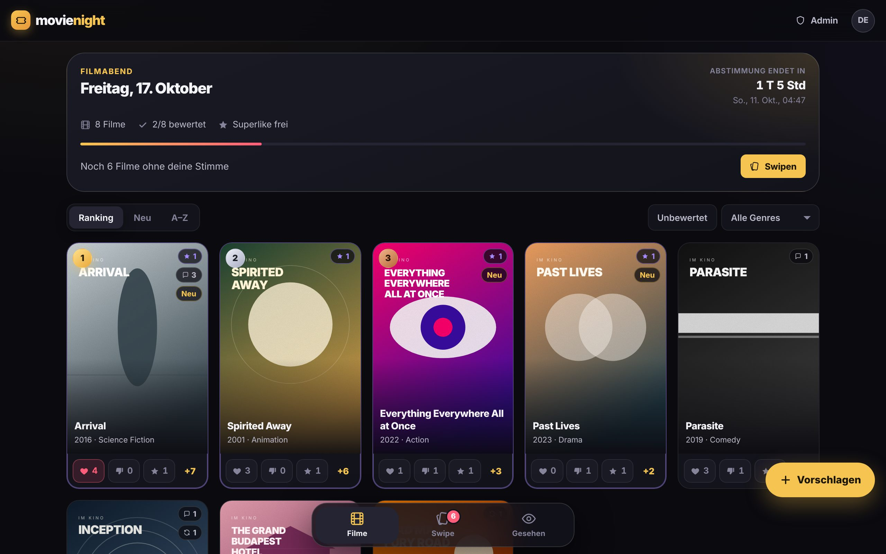
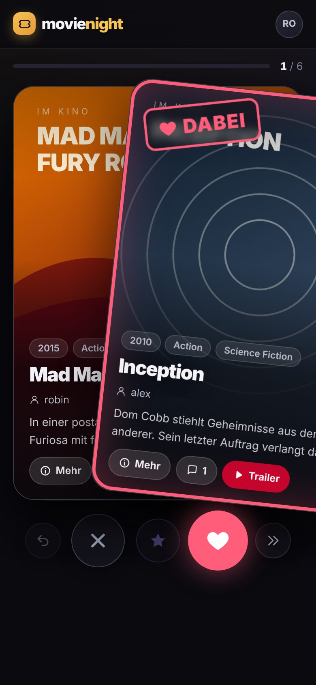
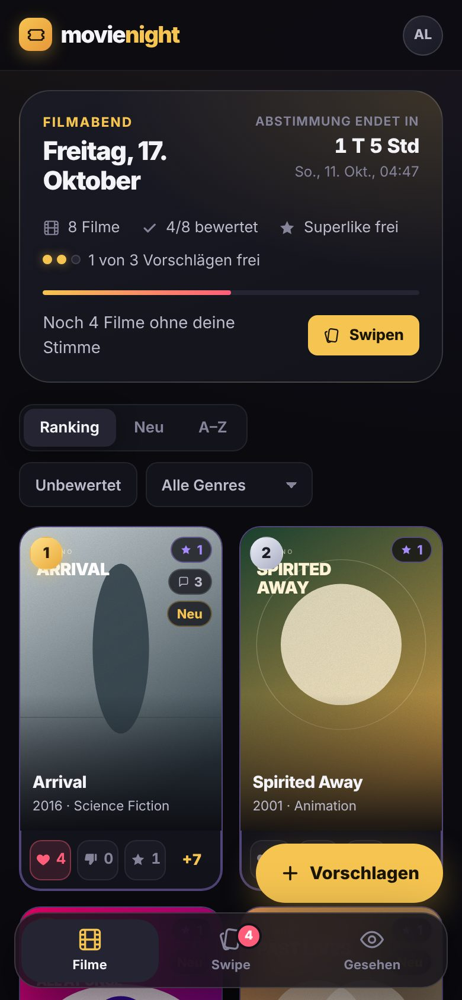
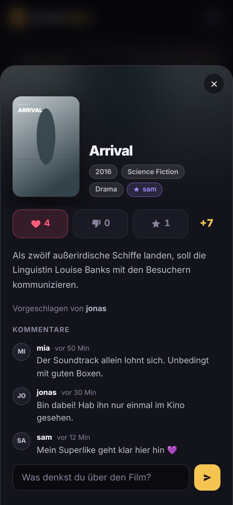

<h1 align="center">movienight</h1>

<p align="center">
  <strong>A self-hosted movie-night voting app for friend groups.</strong><br>
  Propose films, swipe through the shortlist, and let the group decide what you watch on Friday.
</p>

<p align="center">
  <a href="https://github.com/nbomers/movienight/actions/workflows/ci.yml"></a>
  
  
  <a href="LICENSE"></a>
</p>

<p align="center">
  
</p>

<p align="center">
  
  
  
</p>

<p align="center"><sub>Screenshots use the demo data from <code>scripts/seed_demo.py</code> with placeholder poster art.</sub></p>

## How it works

1. The admin starts a **round** with a voting deadline.
2. Everyone **proposes** up to three films (configurable), found through TMDB search or entered by hand.
3. The group **votes**: like, nope, and one superlike per person and round, either in the ranked grid or by swiping through cards.
4. After movie night, the admin **closes the round** and marks the film you watched. Everything else moves on to the next round with fresh votes, and films nobody picks for too long drop out on their own.

> **Note:** The interface is in German, and deadlines are entered and shown in Europe/Berlin time.

## Features

**Voting**
- Ranked poster grid; a superlike counts like three likes, a nope subtracts one
- Swipe mode with drag and flick gestures, keyboard shortcuts, undo, "later" and a summary at the end
- Live countdown to the deadline; voting and proposals close automatically

**Rounds**
- One active round at a time, with optional deadline
- Unwatched films carry over and retire after a configurable number of rounds
- History of every film you watched, with date and who proposed it

**People**
- Invite-only accounts through single- or multi-use links
- Regulars see every round; guests only the rounds they were invited to
- Comments per film; everyone can change their own password
- Admin panel for rounds, guests, invite links and accounts (roles, password reset, deactivation)

**Under the hood**
- FastAPI, SQLite and plain JavaScript modules: no build step, no `node_modules`
- Posters, genres, overviews and German or English trailers from TMDB; works without a TMDB key
- Strict Content-Security-Policy, rate-limited login and invite redemption, tokens revoked on password change

## Quickstart

Requires Python 3.12.

```bash
git clone https://github.com/nbomers/movienight.git
cd movienight
python -m venv .venv && source .venv/bin/activate   # or: conda create -n movienight python=3.12
pip install -r requirements-dev.txt

cp .env.example .env
# Set SECRET_KEY as described in .env.example. TMDB_API_KEY is optional.

python -m scripts.seed_demo        # demo users, films and an active round
uvicorn app.main:app --reload
```

Open <http://localhost:8000> and log in as `demo_admin`, `alex`, `sam` or `robin` (a guest), all with the password `demo-password`.

Without demo data, the app creates the first admin from `FIRST_ADMIN_USERNAME` and `FIRST_ADMIN_PASSWORD` on first start, and refuses to start while no password is set. There is no default password.

Run the checks:

```bash
ruff check .
pytest
```

## Configuration

All settings come from environment variables or a `.env` file.

| Variable | Default | Purpose |
|---|---|---|
| `SECRET_KEY` | *(required)* | Signs login tokens. Generate with `python -c "import secrets; print(secrets.token_urlsafe(48))"` |
| `DATABASE_URL` | `sqlite:///./filmabend.db` | SQLite database file; `.env.example` uses `movienight.db` |
| `TMDB_API_KEY` | *(empty)* | Enables movie search; without it, films are entered by hand |
| `MAX_MOVIES_PER_USER` | `3` | Proposals per person and round (admins are not limited) |
| `ACCESS_TOKEN_EXPIRE_MINUTES` | `10080` | Login lifetime (7 days) |
| `FIRST_ADMIN_USERNAME` | `admin` | Initial admin, created on first start only |
| `FIRST_ADMIN_PASSWORD` | *(empty)* | At least 12 characters; required until an admin exists |
| `AUTH_RATE_LIMIT` | `10` | Failed logins or registrations per client IP … |
| `AUTH_RATE_WINDOW_SECONDS` | `300` | … within this window |
| `CORS_ORIGINS` | `[]` | Only needed when the frontend is served from another origin |

## Self-hosting

The app is a single process that serves the API and the frontend from the same origin. A typical setup:

```
Browser ──HTTPS──▶ Caddy ──▶ uvicorn / FastAPI ──▶ SQLite
                                    │
                                    └──▶ TMDB API (search, details, trailers)
```

`deploy/` contains examples:

- [`deploy/movienight.service`](deploy/movienight.service): systemd unit that binds uvicorn to localhost and enables `--proxy-headers`, so the rate limit sees real client IPs
- [`deploy/Caddyfile.example`](deploy/Caddyfile.example): reverse proxy with automatic HTTPS, plus a variant for use behind Cloudflare Tunnel

Run a single uvicorn worker: the login rate limit is kept in memory.

**Backups.** SQLite runs in WAL mode, so a plain file copy of a running database can miss recent writes. Use SQLite's backup command instead:

```bash
sqlite3 movienight.db ".backup movienight-$(date +%F).db"
```

**Updating.** Pull, install the requirements and restart the service. Schema changes are applied automatically at startup. Check the [changelog](CHANGELOG.md) for anything that needs attention, such as everyone having to log in again after 1.0.0.

## Design decisions

**SQLite instead of Postgres.** A friend group produces a few hundred rows a year, with one writer most of the time. SQLite means no extra service, a single file to back up, and a test suite that runs against the same engine as production. WAL mode and a busy timeout let a group vote at the same moment. If this ever needed several app servers, the database would be the first thing to change.

**No frontend framework.** The UI is a handful of views over a small JSON API. Plain ES modules load directly in the browser, so there is no build step and deploying is copying files. The cost is manual DOM updates and manual escaping: every value from the API goes through one `esc()` helper before it reaches `innerHTML`, and the backend only accepts poster paths and trailer links in the exact shape TMDB produces.

**Round logic.** Exactly one round is active at a time. When the admin closes a round, they mark the film that was watched and it leaves the pool. When the next round starts, all other films from the last round move over, their votes are cleared, and their `rounds_survived` counter goes up. Once it reaches the configured limit (default 4), the film retires. The list stays fresh without anyone cleaning it up by hand.

**Superlikes are derived, not stored.** Whether someone has used their superlike is a query over the current round's votes. An earlier version kept a separate list that could drift from the votes, for example when a superliked film was removed.

**Optimistic voting.** A vote updates the UI immediately and is rolled back if the server rejects it. The grid, the detail view and the swipe deck share one store, so they never disagree.

**Time zones.** Deadlines are entered as Berlin time, converted to UTC for storage and sent to the browser with an explicit offset. SQLite does not store offsets, so the API attaches UTC when reading.

## Security

- **Accounts** exist only through invite links (`secrets.token_urlsafe(32)`). The token travels in the URL fragment, so it never reaches server or proxy logs.
- **Sessions** are signed JWTs bound to the user id and a per-user token version. Changing or resetting a password logs out every other session; deactivating a user takes effect on their next request.
- **Login** answers unknown users and wrong passwords with the same error in the same time. Usernames are unique ignoring case. Failed logins and invite redemptions are rate-limited per IP.
- **Access** is checked on every round-scoped endpoint: guests only see the round they were invited to, including its comments and the TMDB search.
- **Frontend:** no inline scripts or event handlers, and a strict Content-Security-Policy (`script-src 'self'`), so injected markup cannot run code even if an escaping mistake slipped through. A test keeps it that way.

Found a vulnerability? Please report it privately as described in [SECURITY.md](SECURITY.md) rather than opening a public issue.

## Contributing

Issues and pull requests are welcome. Please run `ruff check .` and `pytest` before opening a pull request; CI runs both.

## TMDB attribution

<!-- Add the official TMDB logo from https://www.themoviedb.org/about/logos-attribution as docs/tmdb-logo.svg, then uncomment:
<a href="https://www.themoviedb.org/"></a>
-->

This product uses the TMDB API but is not endorsed or certified by TMDB.

## License

[MIT](LICENSE). The bundled Inter font is licensed under the [SIL Open Font License](frontend/fonts/OFL.txt).
